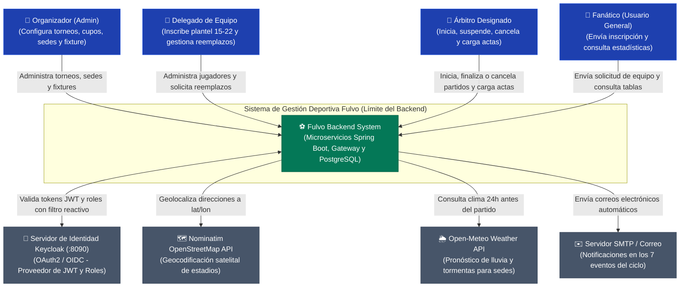
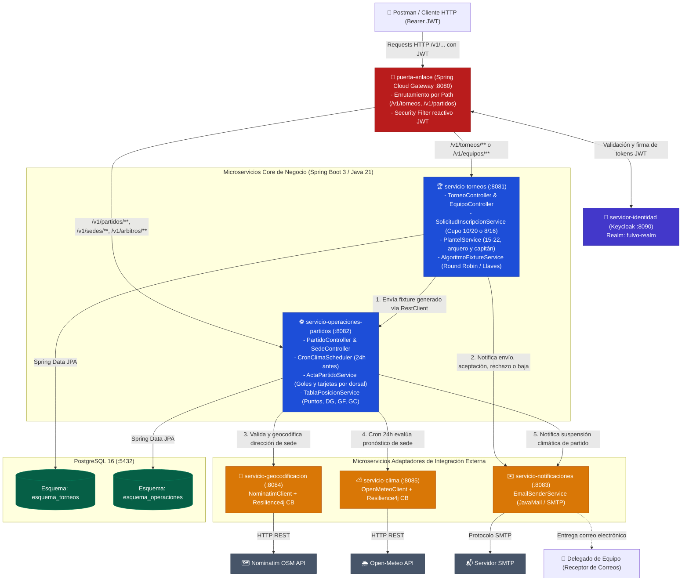
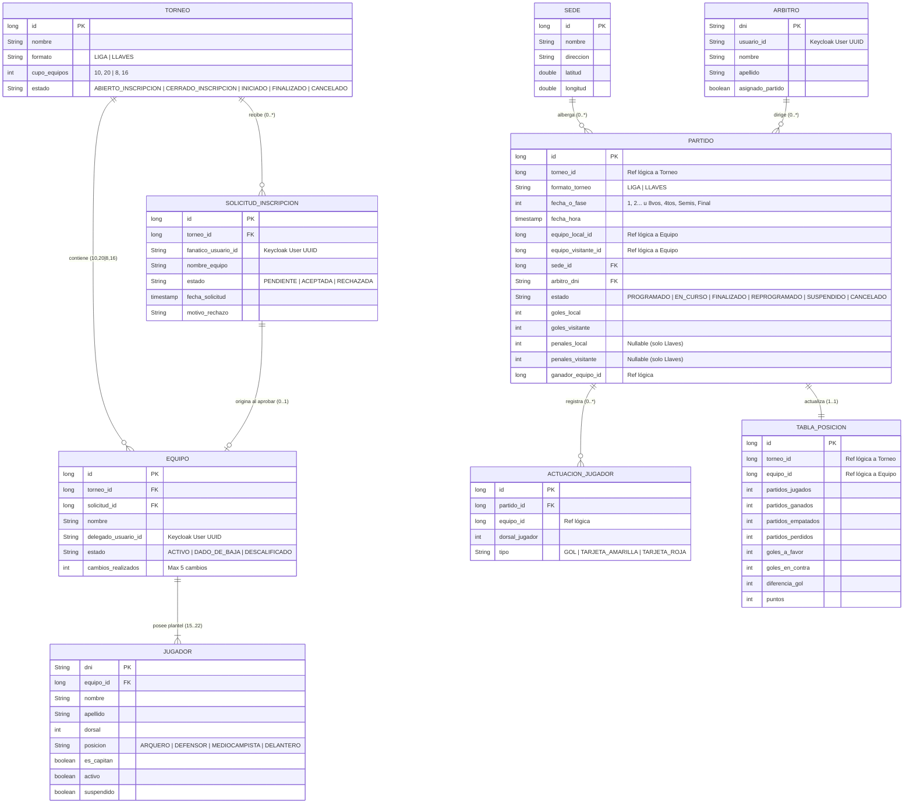

# Fulvo Backend: Especificación de Dominio, Arquitectura y Diagramas
**Asignatura:** Backend de Aplicaciones — UTN FRC (Ciclo Lectivo 2026)  
**Dominio:** Sistema de Gestión de Competencias Deportivas (Fútbol), Operaciones de Partidos y Contingencias.  
**Estado:** Documento de Diseño Aprobado para Implementación y Defensa del MVP.

---

## 1. Definición del Dominio y Proceso de Negocio Central (Criterio NEG-01)

### 1.1. Propósito de la Solución
**Fulvo Backend** es un sistema distribuido basado en microservicios diseñado para coordinar el ciclo completo de torneos deportivos de fútbol (en formatos **Liga / Round Robin** de 10 o 20 equipos, y **Copa / Llaves de Eliminación Directa** de 8 o 16 equipos). 

La arquitectura desacopla funcionalmente:
1. **La gestión organizativa y registral:** Administración de torneos, cupos estrictos, solicitudes de inscripción de fanáticos, designación de delegados de equipo, listas de buena fe de jugadores (15 a 22 con arquero y capitán) y generación matemática del fixture completo.
2. **La logística y operación en campo:** Gestión de sedes (geocodificadas satelitalmente con fallback manual), designación de árbitros, monitoreo meteorológico automatizado a 24 horas, carga de actas arbitrales por dorsal, resolución de tandas de penales y cómputo de tablas de posiciones / estadísticas.

---

### 1.2. Roles Oficiales del Sistema (Seguridad y Acceso)
**Nota de seguridad:** No existen endpoints públicos en el sistema. Todas las consultas exigen un token JWT válido emitido por el `servidor-identidad` (Keycloak).
* **Organizador (`ROL_ORGANIZADOR` / Admin):** Administra torneos, sedes y árbitros; aprueba o rechaza solicitudes de inscripción; puede dar de baja a cualquier equipo o cancelar el torneo completo en cualquier momento.
* **Delegado de equipo (`ROL_DELEGADO`):** Rol temporal otorgado al fanático cuya solicitud de inscripción fue aprobada para un torneo específico. Puede modificar su lista de jugadores pre-torneo y gestionar hasta 5 reemplazos durante la competencia (sin sustituir suspendidos). Una vez finalizado el torneo, vuelve al rol de **Fanático**.
* **Árbitro (`ROL_ARBITRO`):** Exclusivo para el juez designado en un partido específico. Sus únicas cuatro responsabilidades operativas son: **iniciar**, **finalizar** (cargando goles/tarjetas por dorsal y penales si es copa), **suspender** (por fuerza mayor) o **cancelar** (por incidentes de conducta).
* **Fanático (`ROL_FANATICO`):** Usuario general autenticado. Puede enviar **solo una** solicitud de inscripción por torneo y consultar fixtures, tablas de puntos, goleadores y estadísticas de partidos.

---

### 1.3. Recorrido de una Operación Real de Punta a Punta (Historia del MVP)
1. **Configuración del Torneo:** El Organizador crea un torneo definiendo su formato y su cupo exacto (**10 o 20 equipos** para Liga; **8 o 16 equipos** para Llaves). El torneo nace en estado `ABIERTO_INSCRIPCION`. Da de alta sedes (con Nominatim o coordenadas manuales) y árbitros.
2. **Solicitud de Inscripción:** Un Fanático envía una solicitud registrando el nombre del equipo y su plantel de buena fe (entre 15 y 22 jugadores, con posiciones tipificadas: `ARQUERO`, `DEFENSOR`, `MEDIOCAMPISTA`, `DELANTERO`, validando al menos 1 arquero, 1 capitán y DNI único por torneo). El `servicio-notificaciones` le confirma por email el envío de la postulación.
3. **Admisión y Promoción de Rol:** El Organizador evalúa y aprueba la solicitud. El solicitante adquiere el rol de **Delegado de equipo** para esa competencia y se le envía un correo de confirmación de inscripción.
4. **Cierre de Inscripción y Fixture:** Al alcanzarse el 100% del cupo, el Organizador pasa el torneo a `CERRADO_INSCRIPCION`. Posteriormente, genera el fixture completo de una sola vez; `servicio-torneos` procesa los emparejamientos, el torneo pasa a `INICIADO` y se despachan los partidos a `servicio-operaciones-partidos` en estado `PROGRAMADO`.
5. **Monitoreo Meteorológico Automatizado (24 horas antes):** Un Scheduler automático consulta Open-Meteo para las coordenadas de la sede. Si se detectan tormentas o lluvias severas, el partido pasa automáticamente a `SUSPENDIDO` y se notifica por correo al Delegado de equipo.
6. **Disputa de Partido y Acta Arbitral:** El árbitro designado inicia el encuentro (`EN_CURSO`).
   * *Si hay disturbios graves:* El árbitro cancela el partido (`CANCELADO`) y se le da por perdido a ambos equipos (0 puntos en la tabla). En formato Llaves, ambos quedan descalificados y avanza el rival de la otra llave.
   * *Si finaliza en Liga:* El árbitro carga goles y tarjetas por dorsal; el partido pasa a `FINALIZADO` y se actualizan la tabla de posiciones y la tabla de goleadores.
   * *Si finaliza empatado en Llaves:* Es obligatoria la carga del resultado de penales (`penales_local != penales_visitante`) para determinar el clasificado a la siguiente ronda.
7. **Bajas y Reemplazos:** Un equipo puede darse de baja voluntariamente en cualquier fase (abierta, cerrada o iniciado), o ser dado de baja por el Organizador (notificando al Delegado). Durante el juego, el Delegado puede solicitar hasta 5 cambios de jugadores no suspendidos.

---

## 2. Catálogo Formal de Reglas de Negocio (Criterio NEG-02)

| Código | Regla de Negocio | Descripción y Criterio de Aceptación |
| :--- | :--- | :--- |
| **RN-01** | **Cupos Estrictos por Formato** | En formato Liga solo se admiten torneos de **10 o 20 equipos**. En formato Llaves solo se admiten **8 o 16 equipos**. No se puede cerrar la inscripción sin cubrir el 100% del cupo. |
| **RN-02** | **Conformación de Plantel y DNI Único** | Todo equipo debe tener entre **15 y 22 jugadores**, al menos un `ARQUERO` y exactamente un capitán (`esCapitan = true`). Un jugador no puede estar inscripto en más de un equipo en el mismo torneo. |
| **RN-03** | **Límite de Postulación del Fanático** | Un usuario con rol Fanático solo puede tener **una única solicitud de inscripción** activa por torneo. |
| **RN-04** | **Bajas y Cancelaciones Flexibles** | Un equipo puede darse de baja voluntariamente en cualquier momento (con inscripción abierta, cerrada o torneo iniciado). El Organizador puede dar de baja a un equipo o cancelar el torneo en su totalidad en cualquier momento. |
| **RN-05** | **Máximo 5 Reemplazos en Competencia** | Iniciado el torneo, el Delegado puede reemplazar hasta 5 futbolistas de su lista original. El sistema prohíbe taxativamente la sustitución de jugadores con `suspendido = true`. |
| **RN-06** | **Geocodificación Satelital con Fallback** | Al registrar sedes se consulta Nominatim (OpenStreetMap). Ante timeout o caída del servicio (Resilience4j), el Organizador puede cargar latitud y longitud manualmente. |
| **RN-07** | **Suspensión Meteorológica a 24h** | Un proceso automático desatendido evalúa el clima 24 horas antes del partido. Ante condiciones adversas severas, el partido pasa a `SUSPENDIDO` y se avisa por email. |
| **RN-08** | **Exclusividad Arbitral por Partido** | Solo el Árbitro asignado al partido tiene permisos para cambiar su estado a `EN_CURSO`, `FINALIZADO`, `SUSPENDIDO` o `CANCELADO`. |
| **RN-09** | **Cancelación Arbitral por Incidentes** | Si ocurren incidentes, el árbitro cancela el partido (`CANCELADO`), sancionando a ambos con 0 puntos. En formato Llaves, ambos son descalificados. |
| **RN-10** | **Desempate por Penales en Llaves** | En Llaves, todo empate en los 90' exige carga obligatoria de penales (`penales_local != penales_visitante`) para resolver el ganador clasificado. |
| **RN-11** | **Circuito de Notificaciones por Correo** | El sistema despacha emails automáticos por: solicitud enviada, solicitud aceptada, solicitud rechazada, baja confirmada, descalificación por Organizador, cancelación total de torneo y suspensión de partido. |

---

## 3. Máquinas de Estados Oficiales

### 3.1. Máquina de Estados del Torneo (5 Estados)
```
[ ABIERTO_INSCRIPCION ] ──(Cupo 100% lleno y cierra Organizador)──► [ CERRADO_INSCRIPCION ]
          │                                                               │
          │                                                   (Genera fixture)
          │                                                               ▼
          │                                                         [ INICIADO ]
          │                                                               │
          │                                                    (Finaliza último partido)
          │                                                               ▼
          │                                                        [ FINALIZADO ]
          │
          └──(Organizador cancela en cualquier momento)───────────► [ CANCELADO ]
```

### 3.2. Máquina de Estados del Partido (6 Estados)
```
[ PROGRAMADO ] ──(Árbitro asignado inicia)─────────────► [ EN_CURSO ]
       │                                                        │
       │ (Scheduler Clima 24h o Árbitro suspende)               ├─(Árbitro carga acta)──────────► [ FINALIZADO ]
       ▼                                                        │
 [ SUSPENDIDO ]                                                 └─(Árbitro cancela disturbios)──► [ CANCELADO ]
       │                                                                                          (0 pts a ambos)
       └─(Organizador asigna nueva fecha/sede)──► [ REPROGRAMADO ]
                                                        │
                                                        └──(Llega fecha y se inicia)────► [ EN_CURSO ]
```

---

## 4. Matriz de Alcance del MVP (Criterio ALC-01)

| Característica / Capacidad | En el MVP | Fuera del MVP (Futura Fase) |
| :--- | :---: | :--- |
| Autenticación centralizada JWT / OIDC (Keycloak en puerto 8090) | ✅ | |
| Puerta de Enlace reactiva (Spring Cloud Gateway en puerto 8080) | ✅ | |
| Circuit Breaker y Fallbacks con Resilience4j | ✅ | |
| Formato Liga (10/20 eq.) y Formato Llaves (8/16 eq.) | ✅ | |
| Solicitud de inscripción $\rightarrow$ Aprobación $\rightarrow$ Delegado de equipo | ✅ | |
| Plantel de 15 a 22 jugadores, 4 posiciones, arquero y capitán | ✅ | |
| Validación de DNI único por torneo | ✅ | |
| Regla de 5 cambios en competencia sin futbolistas suspendidos | ✅ | |
| Bajas de equipos y cancelación de torneo en cualquier momento | ✅ | |
| Integración Nominatim y Open-Meteo vía microservicios | ✅ | |
| Scheduler automático 24 horas antes del partido | ✅ | |
| Notificaciones SMTP en los 7 eventos del ciclo | ✅ | |
| Acta arbitral por dorsal, goles, tarjetas y penales | ✅ | |
| Cancelación por incidentes con doble pérdida de puntos | ✅ | |
| *Declaración formal y premiación del Campeón* | | ❌ (Fuera de MVP) |
| *Cálculo matemático anticipado del puntero inalcanzable* | | ❌ (Mejora prospectiva) |
| *Bot de Telegram para inscripción* | | ❌ (Post-MVP) |
| *Múltiple inscripción de un equipo a varios torneos* | | ❌ (1 equipo por torneo) |
| *Atributo estadio techado* | | ❌ (Solo condición climática) |
| *Puntaje Fair Play* | | ❌ (Solo tabla de puntos y goles) |

---

## 5. Catálogo de Endpoints RESTful (Criterio API-01)

Cumple las buenas prácticas REST: **versionado (`/v1/...`), uso exclusivo de sustantivos en plural y verbos HTTP adecuados**.  
Base URL: `http://localhost:8080` (a través de `puerta-enlace`). Header: `Authorization: Bearer <JWT>`.

### 5.1. Servicio de Torneos (`servicio-torneos` - Puerto Interno 8081)
* `POST /v1/torneos`  
  * **Rol:** `ROL_ORGANIZADOR`  
  * **Body:** `{"nombre": "Torneo Apertura 2026", "formato": "LIGA", "cupoEquipos": 10}`  
  * **Respuesta:** `201 Created`
* `GET /v1/torneos`  
  * **Rol:** `ROL_FANATICO` / Cualquier usuario autenticado  
  * **Respuesta:** `200 OK` (Listado de torneos y estado de cupos).
* `PATCH /v1/torneos/{id}/estado`  
  * **Rol:** `ROL_ORGANIZADOR`  
  * **Body:** `{"estado": "CERRADO_INSCRIPCION" | "CANCELADO"}`  
  * **Respuesta:** `200 OK`
* `POST /v1/torneos/{id}/solicitudes-inscripcion`  
  * **Rol:** `ROL_FANATICO`  
  * **Body:** Datos del equipo y arreglo de 15 a 22 jugadores (`dni`, `nombre`, `apellido`, `dorsal`, `posicion`, `esCapitan`).  
  * **Respuesta:** `202 Accepted`
* `PATCH /v1/solicitudes-inscripcion/{id}/admision`  
  * **Rol:** `ROL_ORGANIZADOR`  
  * **Body:** `{"estado": "ACEPTADA" | "RECHAZADA", "motivoRechazo": null}`  
  * **Respuesta:** `200 OK`
* `POST /v1/torneos/{id}/fixtures`  
  * **Rol:** `ROL_ORGANIZADOR`  
  * **Respuesta:** `201 Created` (Calcula cruces, pasa torneo a `INICIADO` y envía a Operaciones).
* `DELETE /v1/torneos/{idTorneo}/equipos/{idEquipo}`  
  * **Rol:** `ROL_ORGANIZADOR` o `ROL_DELEGADO`  
  * **Respuesta:** `200 OK` (Baja voluntaria o descalificación; dispara email).
* `POST /v1/equipos/{id}/reemplazos-jugadores`  
  * **Rol:** `ROL_DELEGADO`  
  * **Body:** `{"jugadorSalienteId": 14, "nuevoJugador": {...}}`  
  * **Respuesta:** `200 OK` (Valida no suspendido y límite de 5 cambios).

### 5.2. Servicio de Operaciones de Partidos (`servicio-operaciones-partidos` - Puerto Interno 8082)
* `POST /v1/sedes`  
  * **Rol:** `ROL_ORGANIZADOR`  
  * **Body:** `{"nombre": "Estadio Central", "direccion": "Av. Colón 1500, Córdoba", "latitudManual": null, "longitudManual": null}`  
  * **Respuesta:** `201 Created`
* `POST /v1/arbitros`  
  * **Rol:** `ROL_ORGANIZADOR`  
  * **Body:** `{"dni": "35123456", "usuarioId": "uuid-keycloak", "nombre": "Martín", "apellido": "Pérez"}`  
  * **Respuesta:** `201 Created`
* `GET /v1/torneos/{idTorneo}/partidos`  
  * **Rol:** `ROL_FANATICO` / Cualquier usuario autenticado  
  * **Respuesta:** `200 OK` (Fixture completo ordenado por jornada/fase).
* `POST /v1/partidos/{id}/asignaciones`  
  * **Rol:** `ROL_ORGANIZADOR`  
  * **Body:** `{"sedeId": 1, "arbitroDni": "35123456", "fechaHora": "2026-11-15T16:00:00"}`  
  * **Respuesta:** `200 OK` (Valida anti-superposición horaria).
* `PATCH /v1/partidos/{id}/estado`  
  * **Rol:** `ROL_ARBITRO` (Asignado al partido)  
  * **Body:** `{"estado": "EN_CURSO" | "SUSPENDIDO" | "CANCELADO"}`  
  * **Respuesta:** `200 OK`
* `POST /v1/partidos/{id}/actas`  
  * **Rol:** `ROL_ARBITRO` (Asignado al partido)  
  * **Body:** Arreglo de goles y tarjetas por dorsal, y opcionalmente `penalesLocal` y `penalesVisitante`.  
  * **Respuesta:** `200 OK` (Pasa a `FINALIZADO` y actualiza posiciones).
* `POST /v1/partidos/{id}/reprogramaciones`  
  * **Rol:** `ROL_ORGANIZADOR`  
  * **Body:** `{"nuevaFechaHora": "2026-11-22T17:00:00", "nuevaSedeId": 2}`  
  * **Respuesta:** `200 OK` (Pasa a `REPROGRAMADO`).
* `GET /v1/torneos/{idTorneo}/posiciones`  
  * **Rol:** `ROL_FANATICO` / Cualquier usuario autenticado  
  * **Respuesta:** `200 OK` (Tabla con PJ, PG, PE, PP, GF, GC, DG y Puntos).
* `GET /v1/torneos/{idTorneo}/goleadores`  
  * **Rol:** `ROL_FANATICO` / Cualquier usuario autenticado  
  * **Respuesta:** `200 OK` (Ranking de goleadores por dorsal y equipo).
* `GET /v1/partidos/{id}/estadisticas`  
  * **Rol:** `ROL_FANATICO` / Cualquier usuario autenticado  
  * **Respuesta:** `200 OK` (Resumen de goles y tarjetas del partido).

---

## 6. Diagrama de Contexto (C4 Nivel 1)



---

## 7. Diagrama de Componentes y Contenedores (C4 Nivel 2 y 3)



---

## 8. Diagrama Entidad-Relación (DER)

> **Aislamiento de Bases de Datos:** Persistencia organizada en dos esquemas independientes dentro de PostgreSQL 16: `esquema_torneos` y `esquema_operaciones`. No existen `FOREIGN KEY` físicas entre esquemas; la relación se realiza mediante **claves foráneas lógicas** desacopladas.


