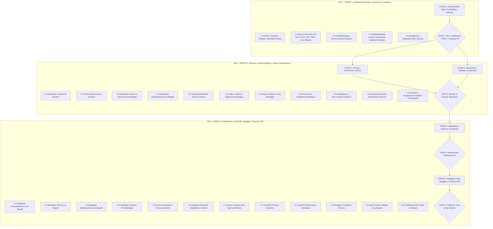

# Plan de Desarrollo Integral - TPI Backend "Fulvo'" (Definitivo y Aprobado)

## Estado del Plan: APROBADO (En Espera de Señal de Inicio)

---

## 1. Decisiones Consolidadas del Proyecto

1. **Nomenclatura de Paquetes y Maven:**
   * `groupId`: `com.fulvo`
   * Raíz de paquetes Java: `com.fulvo.*` (`com.fulvo.torneos`, `com.fulvo.operaciones`, `com.fulvo.gateway`, `com.fulvo.common`, etc.).
   * Proyectos Spring Boot estándar e independientes que heredan de `spring-boot-starter-parent:4.0.8`. La librería `fulvo-common-lib` se instala en `.m2` (`mvn clean install -DskipTests`).
   * Compilación ágil sin tests Java: `mvn clean package -DskipTests`.
2. **Contingencia Offline con WireMock:**
   * Se incluye el servicio `wiremock` en el `docker-compose.yml` para emular las respuestas de OpenStreetMap (Nominatim) y Open-Meteo durante la defensa oral en caso de cortes de red o falta de conectividad en la facultad.
3. **Mecanismo de Brackets en Llaves (8 o 16 Equipos):**
   * Los partidos de fases avanzadas (semifinales, final) se persisten inicialmente con `equipo_uno_id = null` y `equipo_dos_id = null`.
   * Al asentar el árbitro el acta oficial del partido previo (`FINALIZADO`), el sistema promueve automáticamente al equipo ganador al cruce correspondiente de la siguiente fase.
4. **Validación y Verificación 100% en Postman (Criterio API-01):**
   * Se descarta la implementación de tests unitarios y de integración en código Java (JUnit / MockMvc) para maximizar la velocidad en 3 días.
   * La verificación de las reglas de negocio, códigos de error (400, 401, 403, 409, 422) y el proceso central se realiza exclusivamente a través de la colección automatizada en Postman (`pm.test()`).
5. **Resiliencia ante Conflicto de Puerto en PostgreSQL (Puerto 5432 Ocupado en el Host):**
   * **Problema:** Es muy habitual que los desarrolladores tengan instalado PostgreSQL de forma nativa en sus computadoras (ej. servicio Windows `postgresql-x64-16`), ocupando el puerto `5432`. Al ejecutar `docker compose up`, Docker falla con error `bind: address already in use` o `port is already allocated`.
   * **Solución Arquitectónica Dinámica (Sin Romper el Sistema):**
     * **Aislamiento en Red Interna (`bda-net`):** Los microservicios desplegados en Docker se comunican entre sí y con la base de datos a través del DNS interno `postgres-db:5432`. El mapeo del puerto hacia el host **no afecta en absoluto** la comunicación inter-contenedor.
     * **Mapeo Dinámico vía `.env`:** En `docker-compose.yml`, el puerto de PostgreSQL se define como `"${DB_PORT_HOST:-5432}:5432"`. Se provee una plantilla `.env.example`. Si un integrante tiene el `5432` ocupado, crea su archivo `.env` local con `DB_PORT_HOST=5433` (o 5434).
     * **Desarrollo en IDE Local (Fuera de Docker):** Los microservicios configuran su datasource de forma parametrizada: `url: jdbc:postgresql://${DB_HOST:localhost}:${DB_PORT:5432}/fulvo_db?currentSchema=...`. Así, si ejecutan Spring Boot directamente en el IDE, pueden sobreescribir la propiedad pasando `-DDB_PORT=5433` o seteando la variable de entorno `DB_PORT=5433` sin tocar el código fuente ni romper el entorno de los demás integrantes.
     * **Alternativa Administrativa:** Si el desarrollador prefiere liberar el puerto nativo, puede detener el servicio de Windows con: `Stop-Service -Name postgresql*` en PowerShell como Administrador.
6. **Protocolo de Consulta ante Ambigüedades del Agente de IA (Anti-Suposición):**
   * Cuando un Agente de IA tenga dudas sobre el alcance de una regla, un caso de borde no contemplado o una disyuntiva de diseño entre dos enfoques válidos, **está estrictamente prohibido que asuma o improvise**.
   * Debe pausar la ejecución y consultar al desarrollador presentando: 1) La duda concreta, 2) Las opciones viables con sus pros y contras fundamentadas en los apuntes, y 3) Su recomendación técnica.
   * La resolución final acordada con el desarrollador se asienta en `docs/audit/` para garantizar la trazabilidad de las decisiones de diseño.
7. **Estrategia de Ramas en Git y Pull Requests (Feature Branch Workflow):**
   * **Prohibición de push/commit directo a `main`:** La rama `main` se preserva como rama de integración protegida y estable.
   * **Una rama por tarea / subsección (Obligación del Agente):** Antes de programar cualquier tarea, el agente **DEBE crear la rama local y cambiarse a esa misma rama** (`git checkout -b feature/<etapa>-<subseccion>-<descripcion-corta>`).
   * **Prohibición de Push mediante Agentes:** Los agentes de IA **no deben pushear nada a GitHub**. Todo push y apertura de PR lo gestiona el desarrollador a mano.
   * **Flujo de Publicación y Pull Request por el Desarrollador:** Tras implementar la subsección, verificarla con `GUIA_PRUEBAS_MANUALES.md`, actualizar `TASKS.md` y asentar la auditoría en `docs/audit/`:
     1. El desarrollador revisa los cambios locales y pushea la rama al repositorio remoto a mano: `git push -u origin feature/<etapa>-<subseccion>-<descripcion-corta>`.
     2. Crea una **Pull Request (PR)** en GitHub hacia `main` con la evidencia de pruebas y justificación.
     3. Tras la revisión y aprobación, el PR se incorpora a `main` y se eliminan las ramas (remota y local).

---

## 2. Asignación Equilibrada de Responsabilidades por Integrante

Considerando que los 4 integrantes poseen el **mismo nivel de conocimiento de backend en Java**, las responsabilidades se distribuyen en **4 ejes temáticos cohesivos**:

| Integrante | Eje Temático Asignado | Alcance Funcional y Módulos | ¿Cómo prueba manualmente su parte? |
|---|---|---|---|
| **Tomas Augusto Quiróz** | **Perímetro de Acceso, Seguridad y Gateway** | • Docker Compose base y orquestación.<br>• `api-gateway` (Spring Cloud Gateway, `RouteLocatorBuilder`).<br>• Seguridad reactiva OIDC (Keycloak 26, JWT y autoridades de rol `ROL_*`).<br>• Agregación de Swagger UI en Gateway. | Levanta la infraestructura con Docker, obtiene tokens en Keycloak con distintos roles, y prueba desde Postman/curl que el Gateway bloquee accesos anónimos (401), filtre por rol (403) y enrute a las URLs correctas. |
| **Gastón Emiliano Cambos Berrondo** | **Ciclo Registral, Torneos y Admisiones** | • `servicio-torneos` (`esquema_torneos`).<br>• Entidades `Torneo`, `SolicitudInscripcion`, `Equipo`, `Jugador`.<br>• Reglas de admisión y buena fe (15-22 jugadores, arquero, capitán, DNI único).<br>• Algoritmo de fixtures (Round Robin y Llaves).<br>• Límite de 5 reemplazos (RN-11). | Crea un torneo con cupo estricto, postula un equipo con lista de buena fe (probando casos válidos y rechazos), aprueba solicitudes como organizador, cierra cupo al 100%, genera el fixture y prueba sustituciones de futbolistas. |
| **Santiago Mariano Gonzalez** | **Operación en Campo, Arbitraje y Posiciones** | • `servicio-operaciones-partidos` (`esquema_operaciones`).<br>• Entidades `Sede`, `Arbitro`, `Partido`, `ActuacionJugador`, `TablaPosicion`.<br>• Recepción de fixture en lote (`POST /v1/partidos/lote`).<br>• Asignación horaria anti-superposición (±2h).<br>• Circuito arbitral (actas por dorsal, penales y máquina de estados).<br>• Cómputo atómico de tabla de posiciones. | Recibe el fixture generado, da de alta sede y árbitro, los asigna a un partido validando conflicto horario, cambia estado a `EN_CURSO`, carga acta con goles/tarjetas y penales, finaliza el partido y consulta la tabla de posiciones actualizada. |
| **Luis Miguel Urviola Dueñas** | **Contratos Comunes, Adaptadores Externos, Clima y QA Postman** | • `fulvo-common-lib` (DTOs, RFC 7807 `ProblemDetail`, MDC).<br>• `servicio-notificaciones` (Mailpit SMTP).<br>• `servicio-geocodificacion` (Nominatim + WireMock + fallback).<br>• `servicio-clima` (Open-Meteo + WireMock) + Scheduler a 24h.<br>• Colección Postman automatizada integral (`pm.test()`). | Instala la librería común en `.m2`; prueba resolución de direcciones satelitales y fallback manual; dispara el scheduler de tormenta severa y verifica los correos transaccionales en Mailpit (`:8025`); corre la colección Postman de punta a punta. |

---

## 3. Cronograma de Sprints (3 Días) y Compuertas de Calidad



---

## 4. Especificación por Etapas y Subsecciones con Asignaciones Detalladas

> **Directiva de Trabajo en Equipo:** En cada una de las 5 etapas del proyecto, **todos los integrantes del equipo** son responsables de al menos una subsección técnica específica, asegurando una carga balanceada, cohesiva y comprobable.

### ETAPA 1 (Día 1 / Sprint 1): Infraestructura Base, Common Lib, Scaffolding y Gateway Reactivo
**Objetivo:** Disponer de los contenedores de soporte, compilar e instalar la librería común en el repositorio local `.m2`, levantar los esqueletos base de los servicios de negocio y configurar el API Gateway perimetral con enrutamiento y seguridad OIDC.

#### Subsección 1.1: Servicios de Soporte Contenerizados (Postgres, Keycloak, Mailpit y WireMock)
- **Responsable:** **Tomas Augusto Quiróz** (asistido por Luis Miguel en stubs y correo).
- **Partes a Desarrollar:**
  - Configuración del servicio `postgres-db` en `tpi-fulvo/docker-compose.yml` (imagen `postgres:16-alpine`, base `fulvo_db`, puerto dinámico hacia el host `${DB_PORT_HOST:-5432}:5432` y creación de `.env.example` para evitar colisiones con PostgreSQL local preinstalado).
  - Creación del script SQL `initdb/init-schemas.sql` con creación de `esquema_torneos` y `esquema_operaciones`.
  - Configuración del servicio `keycloak-server` en `docker-compose.yml` (`quay.io/keycloak/keycloak:26.5.0`, `start-dev`, puerto host `8090`).
  - Configuración y parametrización del Realm en `keycloak/realm-export.json` con `fulvo-realm`, cliente público `fulvo-backend`, roles (`ROL_ORGANIZADOR`, `ROL_DELEGADO`, `ROL_ARBITRO`, `ROL_FANATICO`) y usuarios de prueba (`admin1`, `arbitro1`, `delegado1`, `fanatico1`) con clave `admin123`.
  - Configuración de `mailpit` (:1025/:8025) y `wiremock` (:8086) en `docker-compose.yml` para contingencia offline.
  - Verificación del levantamiento de contenedores con `docker compose up -d` y obtención de tokens JWT (`POST http://localhost:8090/realms/fulvo-realm/protocol/openid-connect/token`).
- **Criterios de Aceptación:**
  - `docker compose up -d` inicia todos los contenedores en estado `healthy`.
  - PostgreSQL expone los dos esquemas lógicos limpios.
  - Se obtienen tokens JWT válidos mediante Keycloak.

#### Subsección 1.2: Librería Compartida `fulvo-common-lib` (Instalación en `.m2`)
- **Responsable:** **Luis Miguel Urviola Dueñas**
- **Partes a Desarrollar:**
  - Scaffolding de proyecto Maven estándar en `tpi-fulvo/fulvo-common-lib/` con `groupId: com.fulvo`, empaquetado `jar` y versión `1.0.0-SNAPSHOT`.
  - Paquete base `com.fulvo.common.*`.
  - DTOs inter-servicio: `CrucePartidoDTO`, `NotificacionEmailDTO`, `GeocodificacionDTO`, `ClimaPronosticoDTO`.
  - Jerarquía de excepciones de dominio: `BusinessRuleException`, `RecursoNoEncontradoException`, `ConflictoEstadoException`.
  - Manejador `@RestControllerAdvice` estandarizado bajo el estándar **RFC 7807 (`ProblemDetail`)**.
  - Filtro de trazabilidad `CorrelationIdFilter` (`OncePerRequestFilter`) propagando el encabezado `X-Correlation-ID` al contexto `MDC` de SLF4J (Apunte 23).
  - Compilación e instalación en el repositorio local `.m2` mediante `mvn clean install -DskipTests`.
- **Criterios de Aceptación:**
  - El JAR queda compilado e instalado en `~/.m2/repository/com/fulvo/fulvo-common-lib/1.0.0-SNAPSHOT/`.
  - Contratos listos para ser consumidos por los microservicios.

#### Subsección 1.3: Scaffolding Base y Configuración DataSource de `servicio-torneos`
- **Responsable:** **Gastón Emiliano Cambos Berrondo**
- **Partes a Desarrollar:**
  - Creación del proyecto Maven Spring Boot en `tpi-fulvo/servicio-torneos/` (`spring-boot-starter-web`, `spring-boot-starter-data-jpa`, PostgreSQL).
  - Configuración de `application.yml` conectando a PostgreSQL y definiendo `default_schema: esquema_torneos`.
  - Inclusión de la dependencia de `fulvo-common-lib` instalada en `.m2`.
  - Definición de paquetes base `com.fulvo.torneos.*` y verificación del arranque inicial del microservicio en puerto `8081`.
- **Criterios de Aceptación:**
  - El microservicio compila limpiamente (`mvn clean package -DskipTests`) y conecta al esquema de torneos.

#### Subsección 1.4: Scaffolding Base y Configuración DataSource de `servicio-operaciones-partidos`
- **Responsable:** **Santiago Mariano Gonzalez**
- **Partes a Desarrollar:**
  - Creación del proyecto Maven Spring Boot en `tpi-fulvo/servicio-operaciones-partidos/` (`spring-boot-starter-web`, `spring-boot-starter-data-jpa`, PostgreSQL).
  - Configuración de `application.yml` conectando a PostgreSQL y definiendo `default_schema: esquema_operaciones`.
  - Inclusión de la dependencia de `fulvo-common-lib` instalada en `.m2`.
  - Definición de paquetes base `com.fulvo.operaciones.*` y verificación del arranque inicial del microservicio en puerto `8082`.
- **Criterios de Aceptación:**
  - El microservicio compila limpiamente (`mvn clean package -DskipTests`) y conecta al esquema de operaciones.

#### Subsección 1.5: Gateway Reactivo (`api-gateway`) con `RouteLocatorBuilder` y Seguridad OIDC
- **Responsable:** **Tomas Augusto Quiróz**
- **Partes a Desarrollar:**
  - Creación del microservicio Spring Boot reactivo en `tpi-fulvo/api-gateway/` heredando de `spring-boot-starter-parent:4.0.8` con `spring-cloud-starter-gateway`.
  - Configuración de rutas programáticas mediante bean `RouteLocator` con `RouteLocatorBuilder` (Apunte 19) apuntando a los microservicios de backend.
  - Configuración de seguridad reactiva `SecurityWebFilterChain` con validación de JWT emitido por Keycloak y convertidor reactivo de roles `realm_access.roles` a autoridades `ROL_*` (`ROL_ORGANIZADOR`, `ROL_DELEGADO`, `ROL_ARBITRO`, `ROL_FANATICO`) (Apunte 21).
  - Bloqueo perimetral: accesos anónimos con `401 Unauthorized` y accesos sin permisos suficientes con `403 Forbidden`. Exposición de endpoints de Actuator (`/actuator/health`).
- **Criterios de Aceptación:**
  - Petición sin token a `/v1/torneos` rechaza con `401 Unauthorized`.
  - Petición con rol `ROL_FANATICO` a `POST /v1/torneos` rechaza con `403 Forbidden`.
  - `GET /actuator/health` responde `{"status":"UP"}` con HTTP 200.

> 🔴 **COMPUERTA DE CALIDAD (GATE 1):** No se avanza a la Etapa 2 sin que Gateway, Postgres, Keycloak, `fulvo-common-lib` en `.m2` y los scaffoldings de torneos y operaciones estén verificados y operativos.

---

### ETAPA 2 (Día 2 / Sprint 2 - Parte A): Core de Torneos, Admisiones y Contrato de Fixtures
**Objetivo:** Implementar la lógica organizativa, control de admisiones, reglas de planteles de buena fe, motor determinístico de fixture, recepción desacoplada en Operaciones y seguridad perimetral de torneos en Gateway.

#### Subsección 2.1: Modelado JPA y Lógica de Admisión de Torneos (FN-01, FN-04, FN-05, RN-01 a RN-04)
- **Responsable:** **Gastón Emiliano Cambos Berrondo**
- **Partes a Desarrollar:**
  - Entidades JPA en `esquema_torneos`: `Torneo`, `SolicitudInscripcion`, `Equipo` y `Jugador` (utilizando DNI String como PK natural).
  - Endpoint `POST /v1/torneos`: validación de cupo estricto (10/20 Liga, 8/16 Llaves). Cupo inválido $\to$ `400 Bad Request`.
  - Endpoint `POST /v1/torneos/{id}/solicitudes-inscripcion`:
    - Validación de solicitud única por usuario fanático en el certamen (RN-03 $\to$ `409 Conflict`).
    - Validación de lista de buena fe (RN-02): 15 a 22 jugadores, al menos un arquero (`posicion == ARQUERO`), exactamente un capitán (`es_capitan == true`), y DNI único en todo el certamen.
  - Endpoint `PATCH /v1/solicitudes-inscripcion/{id}/admision` (exclusivo `ROL_ORGANIZADOR`):
    - Al aprobar: pasa a `ACEPTADA`, descuenta cupo, crea `Equipo` en `ACTIVO` y promueve al solicitante a `ROL_DELEGADO` (RN-04).
    - Al rechazar: pasa a `RECHAZADA` persistiendo `motivo_rechazo`.

#### Subsección 2.2: Generación Algorítmica Determinística de Fixtures (FN-06, RN-01)
- **Responsable:** **Gastón Emiliano Cambos Berrondo**
- **Partes a Desarrollar:**
  - Endpoint `PATCH /v1/torneos/{id}/estado`: Cierre de inscripción. Bloquea con `409 Conflict` si el cupo de equipos no alcanzó el 100% (RN-01).
  - Endpoint `POST /v1/torneos/{id}/fixtures`:
    - Algoritmo Round Robin (Liga) o árbol de emparejamiento con cruces de fases posteriores inicializados en `null` (Llaves).
    - Transición de estado del torneo a `INICIADO`.
    - Cliente `RestClient` para despachar los cruces generados a `servicio-operaciones-partidos` mediante `POST /v1/partidos/lote` con `CrucePartidoDTO`.

#### Subsección 2.3: Contrato y Recepción de Cruces en Lote en Operaciones (`POST /v1/partidos/lote`)
- **Responsable:** **Santiago Mariano Gonzalez**
- **Partes a Desarrollar:**
  - Endpoint `POST /v1/partidos/lote` en `servicio-operaciones-partidos`: recepción de la lista de `CrucePartidoDTO`.
  - Persistencia transaccional de los partidos recibidos en estado `PROGRAMADO` en `esquema_operaciones`.
  - Desacoplamiento total respecto a las tablas de torneos (claves foráneas lógicas: `torneo_id`, `equipo_local_id`, `equipo_visitante_id`).

#### Subsección 2.4: Integración del Cliente RestClient y Notificaciones de Admisión (FN-14, RN-12)
- **Responsable:** **Luis Miguel Urviola Dueñas**
- **Partes a Desarrollar:**
  - Implementación e instrumentación del cliente `RestClient` en `servicio-torneos` hacia `servicio-notificaciones` (`POST /v1/notificaciones/emails`).
  - Disparo asíncrono de confirmación al fanático ante postulación de equipo (FN-14).
  - Disparo de notificación de resolución (aprobación o rechazo con motivo) hacia el delegado vía Mailpit (RN-12).

#### Subsección 2.5: Enrutamiento Perimetral y Reglas de Seguridad para Torneos en API Gateway
- **Responsable:** **Tomas Augusto Quiróz**
- **Partes a Desarrollar:**
  - Configuración en `RouteLocatorBuilder` de rutas `/v1/torneos/**` y `/v1/solicitudes-inscripcion/**`.
  - Reglas reactivas de autorización perimetral: `POST /v1/torneos` y admisión solo para `ROL_ORGANIZADOR`; creación de solicitudes para `ROL_FANATICO`; consultas de torneos accesibles según roles.

> 🔴 **COMPUERTA DE CALIDAD (GATE 2A):** Microservicios `servicio-torneos` y `servicio-operaciones-partidos` interactúan limpiamente en el despacho y recepción de fixture sin acoplamiento físico.

---

### ETAPA 3 (Día 2 / Sprint 2 - Parte B): Core de Operaciones, Arbitraje, Posiciones y Planteles
**Objetivo:** Gestionar sedes, árbitros, agenda horaria, máquina de estados de partidos, actas por dorsal, penales, tabla de posiciones, ciclo de reemplazos de planteles y seguridad arbitral en Gateway.

#### Subsección 3.1: Sedes, Árbitros y Asignación Anti-Superposición (FN-02, FN-03, FN-07, RN-05)
- **Responsable:** **Santiago Mariano Gonzalez**
- **Partes a Desarrollar:**
  - Entidades JPA en `esquema_operaciones`: `Sede`, `Arbitro`, `Partido`, `ActuacionJugador` y `TablaPosicion`.
  - Endpoints `POST /v1/sedes` y `POST /v1/arbitros`: Registro y persistencia de predios deportivos y colegiados arbitrales.
  - Endpoint `POST /v1/partidos/{id}/asignaciones`:
    - Asignación de `sede_id`, `arbitro_dni` y `fecha_hora`.
    - **Regla Anti-Superposición (RN-05):** Validación algorítmica de que ni la sede ni el árbitro tengan otro partido asignado en la ventana de `fecha_hora ± 2 horas`. Conflicto $\to$ `409 Conflict`.

#### Subsección 3.2: Circuito Arbitral, Actas Oficiales y Desempate en Llaves (FN-09, FN-10, RN-08 a RN-10)
- **Responsable:** **Santiago Mariano Gonzalez**
- **Partes a Desarrollar:**
  - Endpoint `PATCH /v1/partidos/{id}/estado`:
    - Transición a `EN_CURSO`: Validación estricta de identidad del árbitro asignado (`@AuthenticationPrincipal Jwt jwt` vs `partido.arbitro_dni`, RN-08 $\to$ `403 Forbidden`).
    - Cancelación por incidentes (RN-09): Pasa a `CANCELADO`, asigna 0 puntos a ambos en tabla y en Llaves descalifica a ambos equipos.
  - Endpoint `POST /v1/partidos/{id}/actas`:
    - Registro de incidencias por dorsal (goles, tarjetas amarillas y rojas).
    - Definición por penales (RN-10): Si es Llaves y finaliza empatado en los 90', exige `penales_local` y `penales_visitante` sin empate. Asigna `ganador_equipo_id` y promueve automáticamente al equipo a la siguiente fase de llaves.
    - Transición del partido a `FINALIZADO` y disparo transaccional de recálculo de tabla de posiciones.

#### Subsección 3.3: Motor de Tabla de Posiciones y Estadísticas (FN-12)
- **Responsable:** **Santiago Mariano Gonzalez**
- **Partes a Desarrollar:**
  - Servicio transaccional de estadísticas: cómputo atómico de PJ, PG (3 pts), PE (1 pt), PP (0 pts), cálculo de GF, GC y DG.
  - Endpoint `GET /v1/torneos/{idTorneo}/posiciones`: Consulta de tabla de posiciones ordenada bajo criterios reglamentarios.
  - Endpoint `GET /v1/torneos/{idTorneo}/goleadores`: Ranking acumulado de máximos artilleros por dorsal y equipo.

#### Subsección 3.4: Sincronización de Brackets y Ciclo de Reemplazos de Jugadores (FN-11, FN-13, RN-11)
- **Responsable:** **Gastón Emiliano Cambos Berrondo**
- **Partes a Desarrollar:**
  - Endpoint `POST /v1/equipos/{id}/reemplazos-jugadores` para el delegado (`ROL_DELEGADO`):
    - Validación de límite reglamentario: `cambios_realizados < 5` y prohibición de sustituir futbolistas con `suspendido == true` (RN-11). Violaciones $\to$ `400 Bad Request`.
    - Baja lógica del jugador saliente (`activo = false`) y registro e incorporación del entrante.
  - Endpoint `DELETE /v1/torneos/{idTorneo}/equipos/{idEquipo}`: Lógica de baja voluntaria o descalificación de un plantel (FN-13).

#### Subsección 3.5: Seguridad Perimetral y Reglas de Autorización Arbitral en API Gateway
- **Responsable:** **Tomas Augusto Quiróz**
- **Partes a Desarrollar:**
  - Configuración en el Gateway de rutas `/v1/partidos/**`, `/v1/sedes/**` y `/v1/arbitros/**`.
  - Asegurar que la iniciación de partidos y la carga de actas requieran obligatoriamente el rol `ROL_ARBITRO`, las asignaciones de predios requieran `ROL_ORGANIZADOR`, y las consultas de tablas estén abiertas a `ROL_FANATICO`.

#### Subsección 3.6: DTOs Especializados, Excepciones Arbitrales y Contratos Comunes
- **Responsable:** **Luis Miguel Urviola Dueñas**
- **Partes a Desarrollar:**
  - Incorporación en `fulvo-common-lib` de excepciones de dominio específicas: `ArbitroNoAsignadoException`, `ConflictoHorarioException`, `EmpateNoPermitidoException`.
  - DTOs normalizados para actas e incidencias de partidos.
  - Mapeo en `@RestControllerAdvice` con códigos RFC 7807 (400, 403, 409) y reinstalación en `.m2`.

> 🔴 **COMPUERTA DE CALIDAD (GATE 2B):** Circuito arbitral completo, asignación horaria anti-superposición verificada y tabla de posiciones calculada atómicamente.

---

### ETAPA 4 (Día 3 / Sprint 3 - Parte A): Adaptadores Externos, Resiliencia y Scheduler Preventivo
**Objetivo:** Microservicios adaptadores aislados consumiendo APIs externas con Resilience4j, soporte de WireMock, Scheduler preventivo a 24 horas y consistencia de certámenes ante contingencias climáticas.

#### Subsección 4.1: Adaptador de Geocodificación y Fallback (`servicio-geocodificacion`) (FN-02, RN-06)
- **Responsable:** **Luis Miguel Urviola Dueñas**
- **Partes a Desarrollar:**
  - Scaffolding del microservicio Spring Boot `servicio-geocodificacion`.
  - Cliente `RestClient` hacia la API satelital OpenStreetMap (Nominatim) o WireMock (:8086).
  - Protección de tolerancia a fallos con Circuit Breaker (`Resilience4j`).
  - **Lógica de Fallback Manual (RN-06):** Si el servicio externo falla y la petición incluye latitud/longitud manuales, retorna coordenadas con HTTP 201. Si no se proveyeron $\to$ `422 Unprocessable Entity`.

#### Subsección 4.2: Adaptador de Clima y Evaluación de Severidad (`servicio-clima`) (FN-08, RN-07)
- **Responsable:** **Luis Miguel Urviola Dueñas**
- **Partes a Desarrollar:**
  - Scaffolding del microservicio Spring Boot `servicio-clima`.
  - Cliente `RestClient` hacia la API de Open-Meteo o WireMock (:8086).
  - Algoritmo de evaluación climática: precipitación acumulada $> 40\text{ mm}$ o códigos de tormenta severa $\to$ condición climática adversa (`condicion_adversa = true`, RN-07).

#### Subsección 4.3: Adaptador de Notificaciones Transaccionales (`servicio-notificaciones`) (FN-14, RN-12)
- **Responsable:** **Luis Miguel Urviola Dueñas**
- **Partes a Desarrollar:**
  - Scaffolding del microservicio Spring Boot `servicio-notificaciones` con `spring-boot-starter-mail`.
  - Configuración de `JavaMailSender` apuntando al host `mailpit` (puerto 1025).
  - Endpoint transaccional `POST /v1/notificaciones/emails` con captura silenciosa de excepciones SMTP para preservar la resiliencia operativa.

#### Subsección 4.4: Scheduler Climático Preventivo a 24 Horas y Reprogramación (FN-08, RN-07)
- **Responsable:** **Santiago Mariano Gonzalez**
- **Partes a Desarrollar:**
  - Componente `@Scheduled` en `servicio-operaciones-partidos` consultando de forma periódica partidos programados a 24 horas vista.
  - Integración mediante `RestClient` con `servicio-clima`; si las condiciones son adversas, transiciona el partido a `SUSPENDIDO` (RN-07).
  - Endpoint de reprogramación `POST /v1/partidos/{id}/reprogramaciones` para reasignar fecha y sede pasando el partido a `REPROGRAMADO`.

#### Subsección 4.5: Consumo de Notificaciones de Suspensión y Consistencia de Torneos (RN-12)
- **Responsable:** **Gastón Emiliano Cambos Berrondo**
- **Partes a Desarrollar:**
  - Manejo en `servicio-torneos` de los eventos de suspensión y reprogramación de partidos para mantener la coherencia del calendario general del certamen.
  - Actualización de estados para los delegados de los equipos involucrados y seguimiento de fechas pospuestas.

#### Subsección 4.6: Enrutamiento y Aislamiento de Servicios Adaptadores en API Gateway
- **Responsable:** **Tomas Augusto Quiróz**
- **Partes a Desarrollar:**
  - Configuración de rutas en `api-gateway` para los microservicios adaptadores (`/v1/geocodificaciones/**`, `/v1/clima/**`, `/v1/notificaciones/**`).
  - Aislamiento perimetral y validación de seguridad de modo que los adaptadores solo puedan ser invocados por los microservicios autorizados o el organizador, evitando exposición indebida.

> 🔴 **COMPUERTA DE CALIDAD (GATE 3):** Scheduler climático verificado, emails auditados en Mailpit (`http://localhost:8025`) y fallbacks probados.

---

### ETAPA 5 (Día 3 / Sprint 3 - Parte B): Despliegue Docker, Swagger y Postman E2E
**Objetivo:** Orquestación final en Docker con aislamiento perimetral, documentación Swagger agregada en todos los módulos y validación de los 21 escenarios oficiales de prueba en Postman.

#### Subsección 5.1: Orquestación Integral Docker Compose y Red Perimetral `bda-net`
- **Responsable:** **Tomas Augusto Quiróz**
- **Partes a Desarrollar:**
  - Creación del `Dockerfile` canónico multi-etapa/JRE (`eclipse-temurin:21-jre-alpine`) en cada uno de los 6 microservicios.
  - Orquestación unificada en `docker-compose.yml`:
    - Despliegue de los 6 contenedores Java, Postgres, Keycloak, Mailpit y WireMock conectados en la red interna `bda-net`.
    - **Aislamiento Perimetral:** Únicamente `api-gateway` expone el puerto `8080`, Keycloak `8090`, Mailpit `8025` y WireMock `8086`. Los microservicios de negocio operan exclusivamente en la red interna aislada.
  - Configuración de `docker-compose.override.yml` para desarrollo local ágil.

#### Subsección 5.2: Documentación OpenAPI 3.0 del Ciclo Registral y Torneos (`servicio-torneos`)
- **Responsable:** **Gastón Emiliano Cambos Berrondo**
- **Partes a Desarrollar:**
  - Configuración de `springdoc-openapi-starter-webmvc-ui` en `servicio-torneos`.
  - Anotación de endpoints de certámenes, solicitudes de inscripción, admisión, planteles y fixtures.
  - Documentación de schemas de entrada/salida y códigos HTTP de negocio (200, 201, 202, 400, 409).

#### Subsección 5.3: Documentación OpenAPI 3.0 de Operaciones, Sedes y Arbitraje (`servicio-operaciones-partidos`)
- **Responsable:** **Santiago Mariano Gonzalez**
- **Partes a Desarrollar:**
  - Configuración de `springdoc-openapi-starter-webmvc-ui` en `servicio-operaciones-partidos`.
  - Anotación de endpoints de sedes, árbitros, asignaciones horarias, estados de partido, actas y tablas de posiciones.
  - Documentación de esquemas de respuesta y códigos de error (401, 403, 409).

#### Subsección 5.4: Agregación de Swagger UI en API Gateway y Esquemas de Seguridad JWT
- **Responsable:** **Tomas Augusto Quiróz**
- **Partes a Desarrollar:**
  - Agregación centralizada de las especificaciones OpenAPI 3.0 en `api-gateway` para visualización unificada en Swagger UI (`http://localhost:8080/swagger-ui.html`).
  - Documentación del esquema de seguridad JWT Bearer y del formato estándar de errores RFC 7807 (`ProblemDetail`).

#### Subsección 5.5: Automatización de Suite Postman Integral y Entorno de Pruebas
- **Responsable:** **Luis Miguel Urviola Dueñas**
- **Partes a Desarrollar:**
  - Estructuración de archivos en `/postman`: `Fulvo_Backend_Collection.postman_collection.json` y `Fulvo_Local_Environment.postman_environment.json`.
  - Implementación de pre-request scripts y tests en JavaScript (`pm.test()`) con auto-login en Keycloak para Admin, Delegado, Árbitro y Fanático, extrayendo tokens JWT y variables de entorno de forma dinámica.

#### Subsección 5.6: Certificación Colaborativa de Escenarios Oficiales Positivos y Negativos (EP y EN)
- **Responsables y Partes a Desarrollar (Liderado por Luis Miguel Urviola Dueñas):**
  - **Tomas Augusto Quiróz:** Certificación de escenarios de seguridad perimetral y control de acceso (`EN-01` 401 Unauthorized sin token, `EN-02` 403 Forbidden por rol insuficiente).
  - **Gastón Emiliano Cambos Berrondo:** Certificación de escenarios del ciclo registral y torneos (`EP-01` alta torneo, `EP-02` postulación y aprobación, `EP-03` fixture y cierre, `EN-03` cupo inválido, `EN-04` plantilla no reglamentaria, `EN-05` doble inscripción, `EN-10` límite de reemplazos).
  - **Santiago Mariano Gonzalez:** Certificación de escenarios operativos de partidos y arbitraje (`EP-04` asignación sede/árbitro, `EP-05` acta regular y tabla, `EP-06` definición por penales en llaves, `EP-07` suspensión climática y reprogramación, `EN-07` conflicto horario $\pm 2$h, `EN-08` acta por árbitro no asignado, `EN-09` descalificación por incidentes).
  - **Luis Miguel Urviola Dueñas (Líder QA):** Automatización, orquestación general y certificación de escenarios de adaptadores, clima y notificaciones (`EP-08`, `EP-09`, `EN-06`, `EN-11`, `EN-12`) y ejecución completa en Newman.

> 🏆 **COMPUERTA DE APROBACIÓN FINAL (GATE 4):** Backend 100% verificado, documentado en Swagger, desplegado en Docker y certificado de punta a punta con Postman y Mailpit.

---

## 5. Verification Plan

### Verificación Automatizada (Suite Postman con Newman)
```bash
newman run postman/Fulvo_Backend_Collection.postman_collection.json -e postman/Fulvo_Local_Environment.postman_environment.json --reporters cli
```

### Verificación Manual y Servicios de Soporte
1. **Health Check del Gateway:** `curl http://localhost:8080/actuator/health` $\to$ `{"status":"UP"}`.
2. **Inspección de Correos en Mailpit:** Abrir `http://localhost:8025` y verificar la llegada de correos transaccionales.
3. **Consola Keycloak:** Verificar en `http://localhost:8090` que el Realm tenga los roles y usuarios configurados.
4. **Swagger UI Agregado:** Acceder a `http://localhost:8080/swagger-ui.html` para probar interactivamente los endpoints.

---

## 6. Instrucción para el Inicio de la Implementación

Cuando el equipo decida comenzar a programar, solo debe emitir el comando:
> **"Arrancar con la Etapa 1 - Subsección 1.1"**
